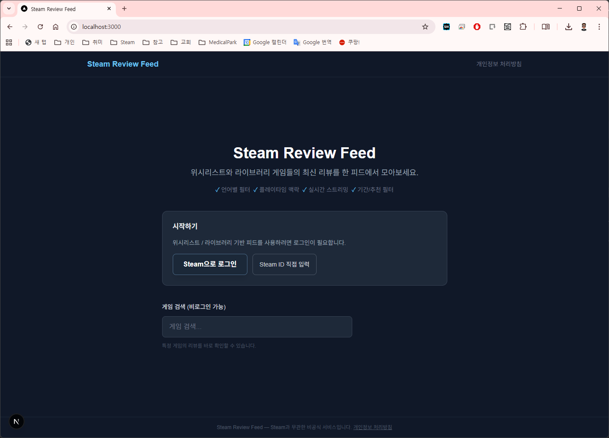
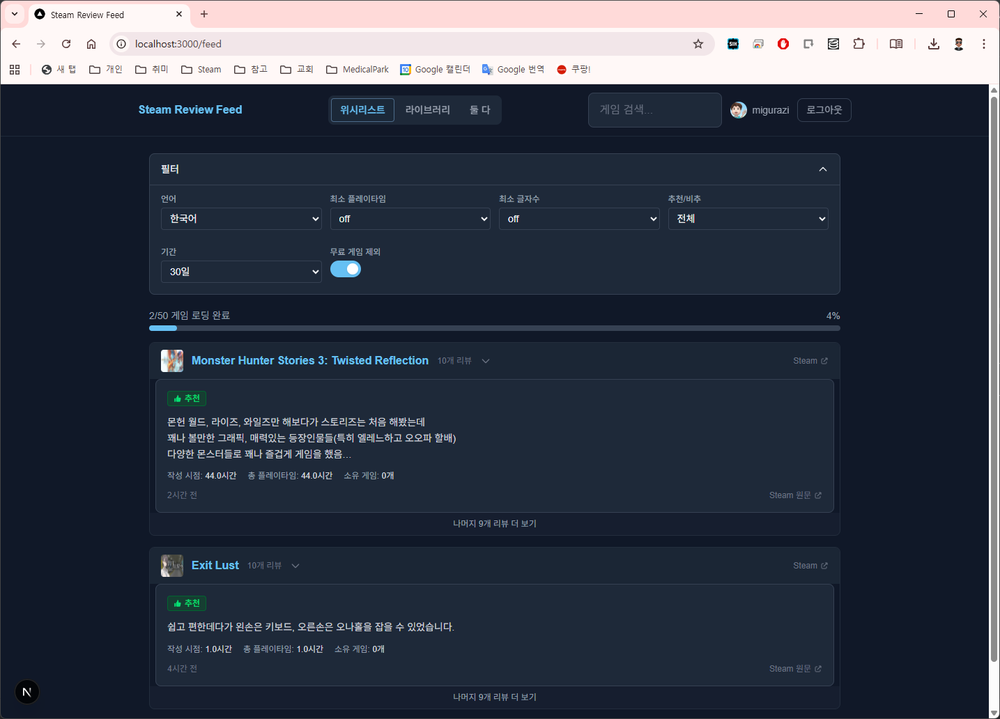

# Steam Review Feed

**English** | [한국어](README.md)

A service that aggregates the latest reviews from your Steam Wishlist and Library games into a single feed.

## Screenshots

| Home | Review Feed |
|------|-------------|
|  |  |

## Key Features

- **Unified Review Feed** — View the latest reviews from Wishlist & Library games in one place
- **Steam Login** — Steam OpenID authentication or direct Steam ID input
- **SSE Progressive Loading** — Real-time streaming with reviews arriving game by game
- **Rich Filters** — Language, date range, playtime, review length, positive/negative, exclude free games
- **Game Search** — Search games by name and browse reviews without logging in
- **Per-Game Reviews** — Detailed review pages for individual games
- **Media Preview** — Hover over game names for video/screenshot popups; full media gallery on game pages

## Tech Stack

| Area | Technology |
|------|------------|
| Framework | Next.js 16 (App Router, TypeScript) |
| Styling | Tailwind CSS 4 |
| DB | SQLite (better-sqlite3) — user/game list persistence |
| Session | iron-session (signed cookies) |
| Cache | lru-cache (in-memory) |
| Auth | Steam OpenID |
| Video | hls.js (HLS streaming) |
| Deployment | Docker (with Nginx reverse proxy config) |

## Project Structure

```
├── app/
│   ├── api/           # API routes (auth, cache, reviews, search, wishlist, library, media)
│   ├── feed/          # Unified review feed page
│   ├── game/[appId]/  # Per-game review page
│   ├── privacy/       # Privacy policy
│   ├── layout.tsx     # Root layout
│   └── page.tsx       # Home (login/search)
├── components/        # React components
├── lib/               # Utilities (cache, DB, session, rate limit, Steam API)
├── middleware.ts       # Auth middleware
├── docs/              # Design docs, screenshots
├── __tests__/         # Tests
├── data/              # SQLite DB (gitignored)
├── logs/              # Event logs (gitignored)
├── Dockerfile
├── docker-compose.yml
└── nginx.conf
```

## Getting Started

### Prerequisites

- Node.js 20+
- Steam Web API Key ([Get one here](https://steamcommunity.com/dev/apikey))

### 1. Environment Variables

Create a `.env.local` file in the project root:

```env
STEAM_API_KEY=your_api_key
SESSION_SECRET=random_string_at_least_32_chars
NEXT_PUBLIC_BASE_URL=http://localhost:3000
```

> `STEAM_API_KEY` and `SESSION_SECRET` are required. The server will not start without them.

### 2. Install & Run

```bash
# Install dependencies
npm install

# Dev server
npm run dev

# Run tests
npm test

# Production build + run
npm run build
node .next/standalone/server.js
```

Open http://localhost:3000 in your browser.

### 3. Docker Deployment

Set up environment variables before running Docker:

```bash
# Create .env file (docker-compose auto-loads it)
cp .env.local .env

# Build and run
docker-compose up --build
```

SQLite DB is stored in the `data/` volume.
To enable the Nginx reverse proxy, uncomment the nginx service in `docker-compose.yml`.

## Troubleshooting

### PowerShell security error when running `npm` on Windows

```
npm : File C:\Program Files\nodejs\npm.ps1 cannot be loaded because running scripts is disabled...
+ CategoryInfo : SecurityError: (:) [], PSSecurityException
```

The PowerShell execution policy is blocking script execution. Choose one of the following:

**Option 1 — Change execution policy (run as Admin, permanent)**
```powershell
Set-ExecutionPolicy RemoteSigned
```

**Option 2 — Allow for current session only**
```powershell
Set-ExecutionPolicy -Scope Process -ExecutionPolicy RemoteSigned
```

**Option 3 — Use cmd instead**
```
cmd
npm install
```

## License

[MIT](LICENSE)
