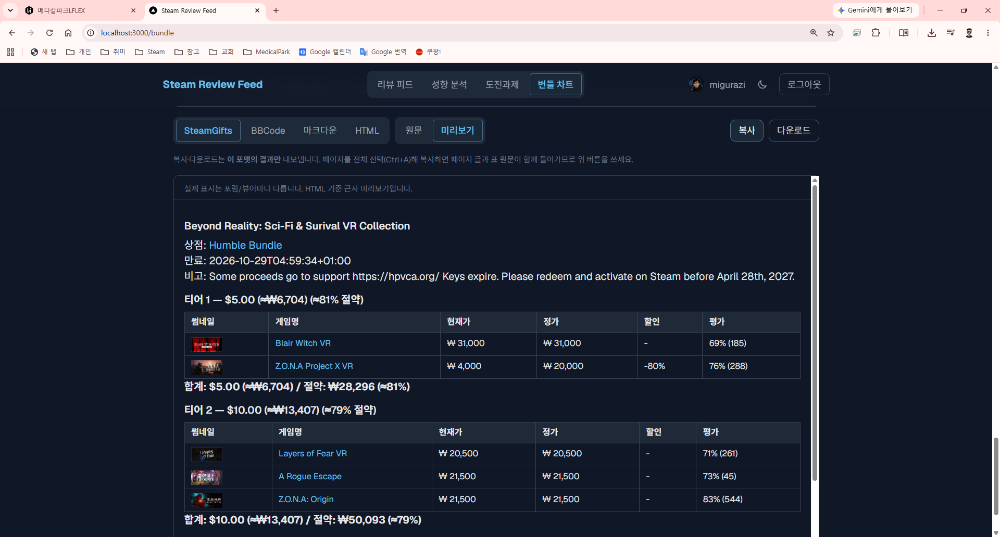

# Steam Review Feed

**English** | [한국어](README.md)

A service that aggregates the latest reviews from your Steam Wishlist and Library games into a single feed.

## Screenshots

| Home | Review Feed | Bundle Chart Maker |
|------|-------------|--------------------|
| [](docs/screenshots/home.png) | [](docs/screenshots/feed.png) | [](docs/screenshots/bundle.png) |

## Key Features

- **Unified Review Feed** — View the latest reviews from Wishlist & Library games in one place
- **Taste Analysis + Recommendations** (`/recommend`) — Extracts genre/category signals from your library playtime and recommends games in two tracks (library-unplayed / wishlist). Matching uses **cosine similarity**, and the ranking blends in **review scores** (with a review badge on each card). Card-farming short plays are filtered by a user-adjustable threshold. Wishlist cards show current prices, with optional **value-for-money ranking** (discount appeal) and an "on sale only" filter. An optional **store deal discovery** track recommends discounted games you don't own that match your taste. Value, on-sale-only and result count re-rank **instantly on the client** without re-running the analysis; result sections are collapsible
- **Achievements Dashboard** (`/achievements`) — Scans your whole library's achievement progress via SSE, sorted by completion. Expand a game for its per-achievement list (icon / global rarity / unlock time), a collapse-all control, and change alerts when a game's achievement schema is updated (added / removed / perfect-broken)
- **Bundle Chart Maker** (`/bundle`) — Create a table showcasing Steam game bundles on forums, with each game's thumbnail, link, current/original price (KRW), discount rate, and review score, plus bundle total and savings percentage. Copy to clipboard or download as 4 formats: SteamGifts markdown, BBCode, plain markdown, or HTML. Three input methods: IsThereAnyDeal recent bundles + Steam package expansion + manual entry (store URL, app ID, name search). Edit tier structures (like Humble Bundle's "Beat the Average"). **Currency conversion** (free API, 12-hour cache) converts bundle prices (USD, etc.) to KRW and calculates savings % · **free-form price note** for per-item pricing not provided by ITAD · **uncertain match "?" badge** (name-search results) · **raw/preview toggle** (HTML renders the actual table, markdown shows approximation) · content safety (HTML links open in new tabs, markdown escapes special chars). ITAD API key is optional (free, get at https://isthereanydeal.com/apps/my/) — without it, manual entry, package expansion, copy, and download work normally
- **Self-Hosting Setup Wizard** — On first launch with no Steam API key, register it (and optionally your ITAD API key) through the `/setup` screen in the browser (saved to `.env.local`) — no manual file editing
- **Steam Login** — Steam OpenID authentication or direct Steam ID input
- **SSE Progressive Loading** — Reviews collected in parallel and streamed in real-time
- **Rich Filters** — Language, date range, playtime, review length, positive/negative, exclude free games
- **Game Search** — Search games by name and browse reviews without logging in
- **Per-Game Reviews** — Detailed review pages for individual games
- **Media Gallery** — Hover over game names for video/screenshot popups with prev/next navigation; full media gallery on game pages
- **Light/Dark Theme** — Auto-detects system preference + manual toggle (light/dark/system)

## Tech Stack

| Area | Technology |
|------|------------|
| Framework | Next.js 16 (App Router, TypeScript) |
| Styling | Tailwind CSS 4 (class-based dark mode) |
| DB | SQLite (better-sqlite3) — user/game list persistence |
| Session | iron-session (signed cookies) |
| Cache | lru-cache (in-memory) + SQLite persistent cache (game metadata, recommendation results) |
| Auth | Steam OpenID |
| Video | hls.js (HLS streaming) |
| Testing | Vitest (556 tests) |
| Deployment | Docker + GitLab CI/CD |

## Project Structure

```
├── app/
│   ├── api/           # API routes (auth, cache, reviews, search, wishlist, library, media, recommend, achievements, bundle, fx, setup)
│   ├── feed/          # Unified review feed page
│   ├── recommend/     # Taste analysis + recommendations page
│   ├── achievements/  # Achievements dashboard page
│   ├── bundle/        # Bundle chart maker page
│   ├── setup/         # First-run setup wizard (register Steam API key · optional ITAD key)
│   ├── game/[appId]/  # Per-game review page (+ achievements summary section)
│   ├── privacy/       # Privacy policy
│   ├── layout.tsx     # Root layout (ThemeProvider, FOUC prevention)
│   └── page.tsx       # Home (login/search)
├── components/        # React components (ThemeProvider, MediaPlayer, ReviewCard, AppNav, AchievementRow, etc.)
├── lib/
│   ├── constants.ts   # Shared constants (PAGE_SIZE, RATE_LIMIT, achievement concurrency/budget, etc.)
│   ├── app-root.ts    # App data root path (works around standalone cwd)
│   ├── env.ts         # Environment variable validation
│   ├── init.ts        # Server initialization (env validation + DB scheduler)
│   ├── cache.ts       # In-memory TTL + LRU cache
│   ├── db.ts          # SQLite DB initialization and queries
│   ├── logger.ts      # JSONL event logging
│   ├── rate-limit.ts  # Per-user rate limiting
│   ├── outbound-limit.ts   # Global outbound semaphore + daily call budget (achievement scan)
│   ├── achievement-diff.ts # Achievement schema diff + snapshot guard
│   ├── achievement-store.ts # Achievement persistence layer (schema/progress/alerts)
│   ├── achievement-scan.ts # Achievement scan orchestration
│   ├── session.ts     # iron-session management
│   ├── bundle/        # Bundle chart maker (types, format, parsing, totals)
│   ├── itad/          # IsThereAnyDeal API client (recent bundles, UUID→appid mapping)
│   ├── fx.ts          # Exchange rates (open.er-api.com, USD→KRW, 12-hour cache)
│   ├── env-file.ts    # .env.local upsert utility
│   └── steam/         # Steam API client, types, sorting, filters, taste profile
├── scripts/setup-env.mjs   # First-run .env.local bootstrap (auto-generates SESSION_SECRET)
├── __tests__/         # Unit tests (38 files, 556 tests)
├── middleware.ts       # Auth middleware (Edge Runtime)
├── Dockerfile
├── docker-compose.yml
├── .gitlab-ci.yml     # GitLab CI/CD pipeline
└── nginx.conf
```

## Getting Started

### Prerequisites

- **Node.js 20+** ([Official download](https://nodejs.org/en/download))
  - On Windows, running `setup.bat` will offer to install Node.js automatically via winget if it is missing
  - Direct winget install: `winget install OpenJS.NodeJS.LTS`
- Steam Web API Key ([Get one here](https://steamcommunity.com/dev/apikey))
- (Optional) IsThereAnyDeal API Key ([Get one here](https://isthereanydeal.com/apps/my/)) — only needed for the Bundle Chart Maker (`/bundle`) ITAD bundle list. Manual input, Steam expansion, and copy/download work without it

### Quick Start (Windows, recommended for non-developers)

**No file editing** — double-click the batch files, then register your key once in the browser.

1. **Install Node.js** — double-click `setup.bat` (offers winget auto-install if missing). Skip if already installed.
2. Double-click `setup.bat` → `build.bat` → `start.bat` in order.
   - `setup.bat`: `npm install` + creates `.env.local` (**SESSION_SECRET auto-generated**).
   - `build.bat`: production build.
   - `start.bat`: runs the server and **opens the browser automatically**.
3. On the **setup screen (`/setup`)** that appears, paste your [Steam API key](https://steamcommunity.com/dev/apikey) and click "Save & Start". Done.
   - The key is stored only in this machine's `.env.local` and takes effect immediately (no restart).
   - To change it later, edit `STEAM_API_KEY` in `.env.local` directly.
   - (Optional) Register your [ITAD API key](https://isthereanydeal.com/apps/my/) on the same screen to use the Bundle Chart Maker's ITAD bundle list. Everything else works without it.

| File | Action |
|------|--------|
| `setup.bat` | Check/install Node + `npm install` + create `.env.local` (SESSION_SECRET auto) |
| `dev.bat` | Dev server (`npm run dev`) |
| `build.bat` | Production build (`npm run build`) |
| `start.bat` | Standalone server + auto-open browser |

### Getting a Steam API Key (first time)

How to obtain the key you paste into the setup screen in step 3 above.

1. Go to [steamcommunity.com/dev/apikey](https://steamcommunity.com/dev/apikey) and sign in with your Steam account.
2. Enter any value for "Domain Name" (e.g. `localhost`), agree to the terms, and click "Register".
3. Copy the **32-character key** shown and paste it into the `/setup` screen.

> (Optional) To also use the Bundle Chart Maker's ITAD bundle list, register an app at [isthereanydeal.com/apps/my](https://isthereanydeal.com/apps/my/) to get an ITAD key and add it on the same `/setup` screen. Everything else works without it.

### After It Starts

Running `start.bat` opens your browser automatically (if not, go to `http://localhost:3000`).

1. **Sign in with Steam** — click "Sign in with Steam" (OpenID) or enter your Steam ID directly. Your wishlist/library must be public for the app to read your game lists.
2. **Review feed** — the latest reviews for your wishlist/library games are collected and shown automatically. Use the top tabs (Wishlist · Library · Both) and filters (language, period, playtime, recommended/not, ...) to adjust the scope.
3. **Other features** — use the top menu for **Taste Analysis** (`/recommend`), **Achievements** (`/achievements`), and **Bundle Chart Maker** (`/bundle`). The Bundle Chart Maker works without signing in.
4. **Stop / restart** — close the open `start.bat` console window to stop the server. Next time, just double-click `start.bat` again (setup/build are one-time only).

### Environment Variables (manual, advanced)

To configure without the batch files, create `.env.local` in the project root:

```env
STEAM_API_KEY=your_api_key   # leave empty to be prompted at /setup on first run
SESSION_SECRET=random_string_at_least_32_chars   # auto-generated by setup.bat/start.bat
NEXT_PUBLIC_BASE_URL=http://localhost:3000
ITAD_API_KEY=   # optional (bundle chart maker), get one at https://isthereanydeal.com/apps/my/
```

> `SESSION_SECRET` is auto-generated by `node scripts/setup-env.mjs`. If `STEAM_API_KEY` is empty, the first visit redirects to the `/setup` page. `ITAD_API_KEY` is optional.

#### Manual (npm)

```bash
# Install dependencies
npm install

# Dev server
npm run dev

# Run tests
npm test

# Production build (standalone + static files auto-copied)
npm run build

# Production server
npm run start:standalone
```

> **Note:** `start:standalone` auto-loads `.env.local` via `--env-file`. In standalone mode, Next.js does not read `.env.local` on its own.

Open http://localhost:3000 in your browser.

### 3. Docker Deployment

```bash
# Create .env file (docker-compose auto-loads it)
cp .env.local .env

# Build and run
docker-compose up --build
```

SQLite DB is stored in the `data/` volume.
To enable the Nginx reverse proxy, uncomment the nginx service in `docker-compose.yml`.

### 4. GitLab CI/CD

A `.gitlab-ci.yml` is included. Register these variables in GitLab > Settings > CI/CD > Variables:

| Variable | Description |
|----------|-------------|
| `SSH_PRIVATE_KEY` | Deploy server SSH key |
| `SSH_KNOWN_HOSTS` | Deploy server known_hosts |
| `SSH_USER` / `SSH_HOST` | Deploy server access |
| `STEAM_API_KEY` | Steam API key |
| `SESSION_SECRET` | Session encryption key |
| `ITAD_API_KEY` | (Optional) IsThereAnyDeal API key — Bundle Chart Maker ITAD list |
| `NEXT_PUBLIC_BASE_URL` | Service URL |

Pipeline: `develop`/`main` push -> Docker image build -> GitLab Registry push -> Manual deploy

## npm Scripts

| Command | Description |
|---------|-------------|
| `npm run dev` | Dev server (HMR, auto-loads .env.local) |
| `npm run build` | Production build + copy static files to standalone |
| `npm run start` | next start (dev production server) |
| `npm run start:standalone` | Standalone server (auto-loads .env.local) |
| `npm run lint` | ESLint check |
| `npm test` | Run Vitest tests |

## Performance / Cache

### Analysis speed and Steam calls (`/recommend`)

Game metadata for taste analysis is fetched from the official API host's **`IStoreBrowseService/GetItems`** (no key needed), **100 games per call**. One response carries genres (genre tags), categories, release status, header image, review summary and price, so metadata, wishlist prices and review scores share one cache.

- Speed: ~0.3 s per call with 0.5 s between calls — an uncached 5,000-game library takes about a minute.
- Traffic: only the needed fields, ~2–3 KB per game.
- Genres are the Steam genre tags (Action, RPG, ...) among the game's top user tags. Category names come from `GetStoreCategories`.
- Prices: only single-game purchase options are used (bundle prices are ignored). Wishlist games whose cheapest option is bundle-only get their single-game price from `appdetails` (skipped during a store 429 backoff). 100%-off giveaways are not treated as free-to-play. If a price lookup fails, the last price seen within 24 hours is shown greyed out.
- Deal discovery's candidate list (store search) and the game detail page's price refresh use the store host.

### Cache

- Game metadata: in-memory LRU + **SQLite persistent cache** (`store_meta_cache`, 7 days), reused across re-analysis and server restarts. During a GetItems outage, expired metadata (even older than 7 days) is used so the analysis can still run.
- Prices 1 hour (+ last-known price 24 hours), review summaries 6 hours (1 hour for "no reviews").
- Two in-memory caches: a general one (10,000 entries) and a per-game one for metadata / review summaries / prices (60,000 entries), so a large first analysis doesn't evict other users' cache.
- Results are stored in `recommendation_cache` and shown instantly on the next visit, together with a re-ranking pool so value / on-sale-only / count changes need no re-analysis (they're also excluded from the cache key).
- Closing the tab mid-analysis keeps partial results gathered up to ~30 seconds earlier.
- **Fast mode** caps the metadata lookups (unplayed candidates / taste sample) to reduce work on very large libraries.

## Troubleshooting

### PowerShell security error when running `npm` on Windows

```
npm : File ... cannot be loaded because running scripts is disabled...
+ CategoryInfo : SecurityError: (:) [], PSSecurityException
```

**Option 1 — Change execution policy (Admin PowerShell, permanent)**
```powershell
Set-ExecutionPolicy RemoteSigned
```

**Option 2 — Allow for current session only**
```powershell
Set-ExecutionPolicy -Scope Process -ExecutionPolicy RemoteSigned
```

**Option 3 — Use cmd instead**
```
cmd
npm install
```

### CSS not loading in standalone mode

`npm run build` automatically copies static files via the `postbuild` script.
If you built manually, copy static files yourself:

```bash
cp -r .next/static .next/standalone/.next/static
cp -r public .next/standalone/public
```

### Environment variable errors in standalone mode

Standalone mode does not auto-load `.env.local`:

```bash
# Correct way to run
node --env-file .env.local .next/standalone/server.js

# Or use npm script
npm run start:standalone
```

## License

[MIT](LICENSE)
